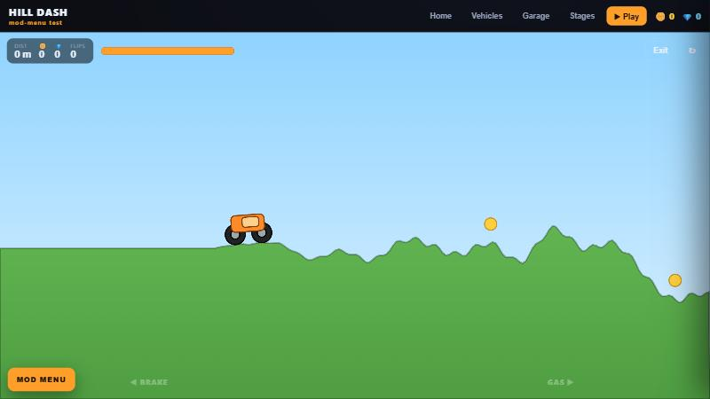
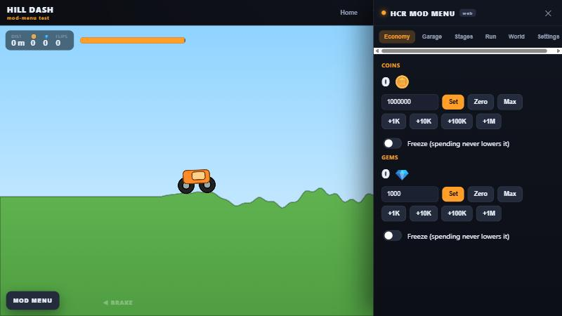

# Hill Dash — Mod Menu Test 🚙

A tiny **clean-room** browser hill-climbing game, built from scratch to demo and test an
**in-game mod menu**. Play it and open the mod menu from any device — phone, laptop, your other PC.

**▶ Play:** https://spec012.github.io/hcr-modmenu-test/  *(live after the first deploy)*




## What it is

- An original 2D physics climber: drive up procedural hills, grab coins and gems, don't run out of
  fuel or flip onto your roof.
- 6 vehicles, 6 stages, a garage with 5 upgradable parts each.
- A full **mod menu** (press **Insert** or **F1**, or tap **MOD MENU**):
  - **Economy** — set / add / zero / max coins & gems, freeze so spending never lowers them
  - **Garage** — unlock all vehicles, max every part, per-part level sliders, keep-unlocked
  - **Stages** — unlock any or all stages
  - **Run** — infinite fuel, no-crash, instant refill
  - **World** — game-speed 0.1×–4×, gravity & wheel-torque toys
  - **Settings** — accent colour, HUD toggle, wipe save

Progress is saved in your browser (`localStorage`), so each device keeps its own garage.

## Controls

| | |
|---|---|
| Gas / Brake | **→ / ←** or **D / A**, or the on-screen pads (touch) |
| Mod menu | **Insert** or **F1**, or the **MOD MENU** button |
| Exit run | **Esc** |

## Run it locally

No build step — it's plain HTML/CSS/ES modules. Serve the folder with anything, e.g.:

```bash
node serve.mjs 8099
# then open http://localhost:8099
```

(ES modules need `http://`, not `file://`.)

## Tests

Pure game logic (save model, economy, upgrade costs, mod-menu actions) is unit-tested with Node's
built-in runner:

```bash
node --test
```

## How it relates to the native mod menu

This repo is the **publishable, clean-room** half of a learning project about how upgrade-driven
games store coins, gems and vehicle upgrades. It reproduces only observed *behaviour* —
defaults, the `base × (level+1)²` upgrade cost, the "re-buying an owned level is free" rule, and
the coin clamp — in entirely original code. **No game files, assets, decompiled code, or memory
addresses from any commercial game are included here.**

## Disclaimer

Fan-made learning project. **Not affiliated with, endorsed by, or using any assets from Fingersoft
or any other publisher.** "Hill Dash" and all art here are original. Single-player, offline, for fun.

## License

[MIT](LICENSE) © 2026
